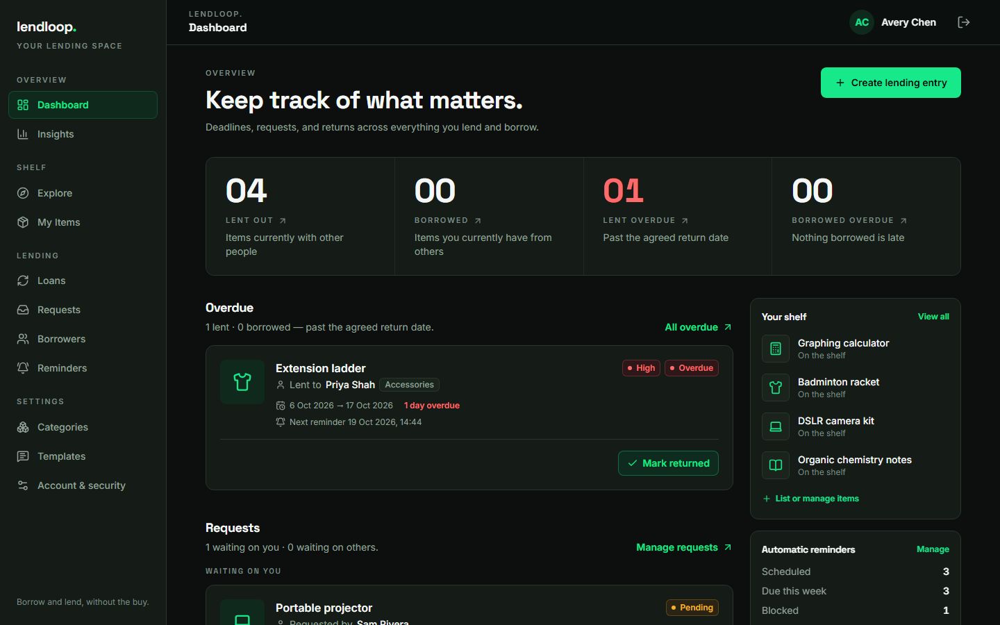
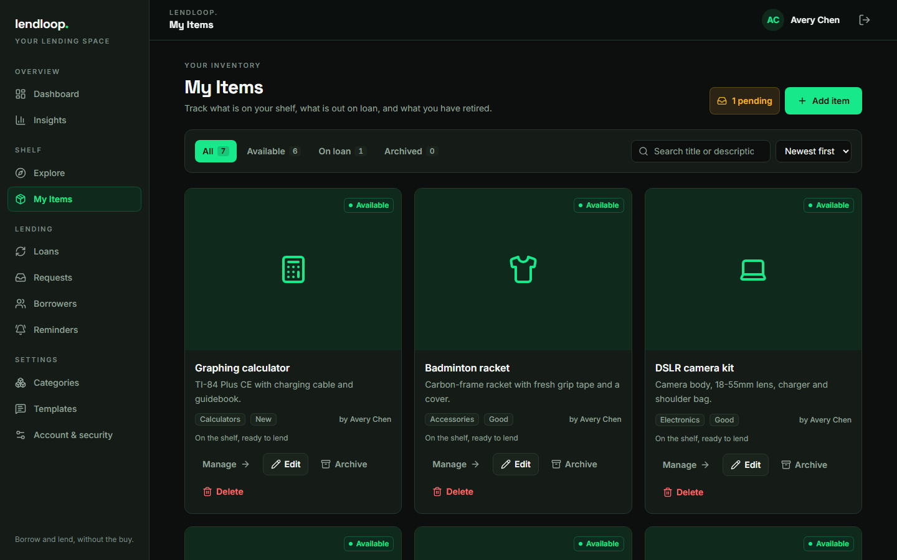
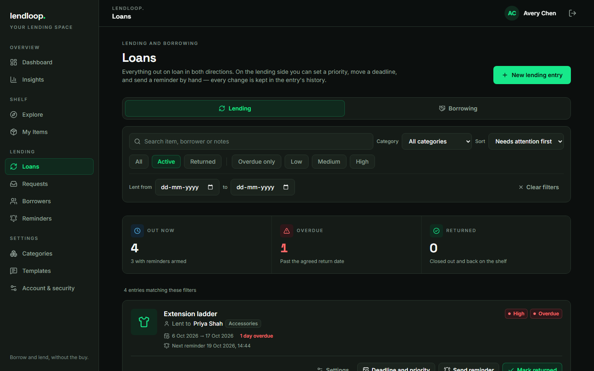
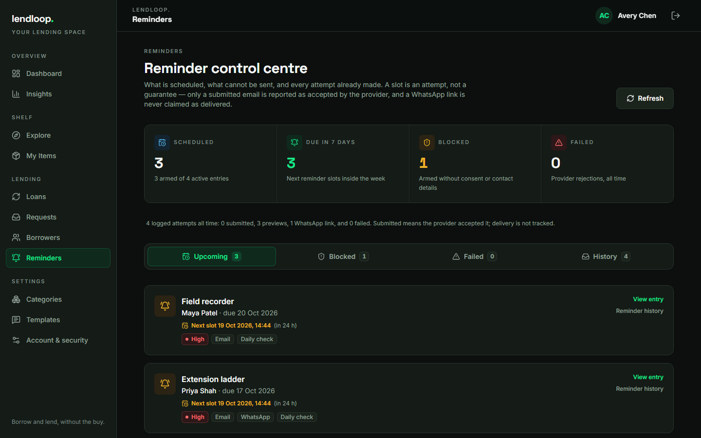
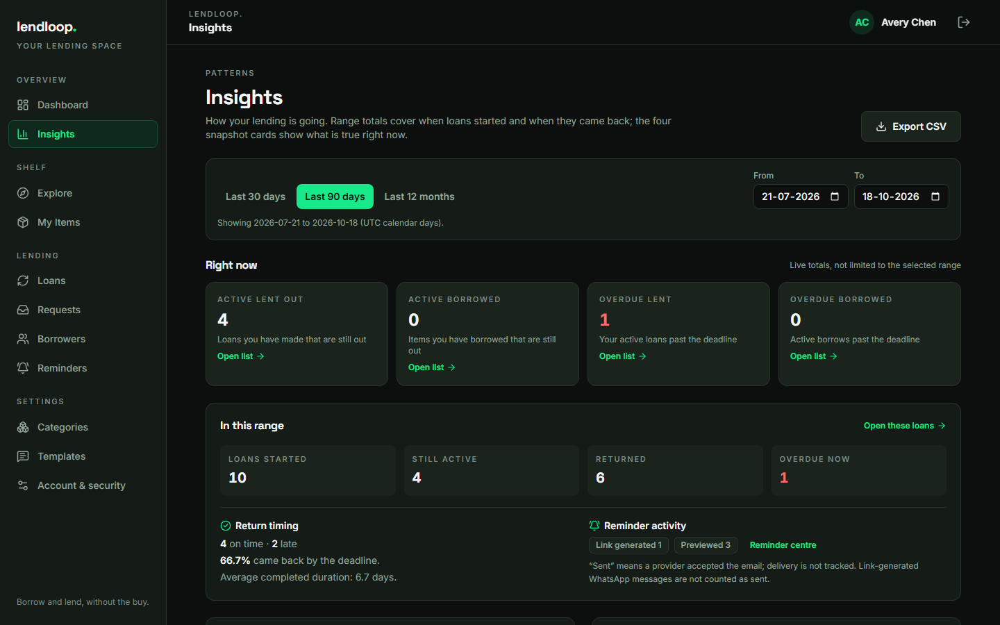
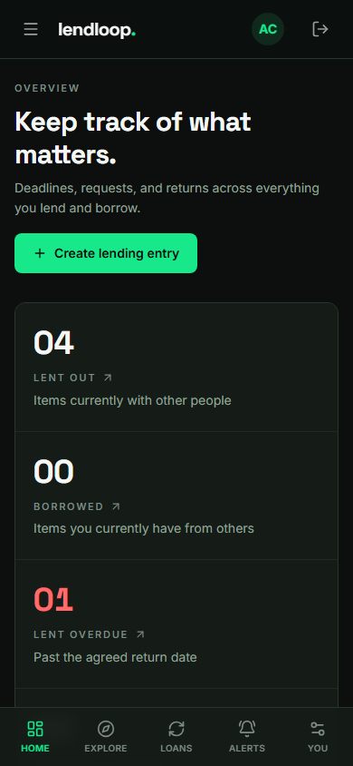
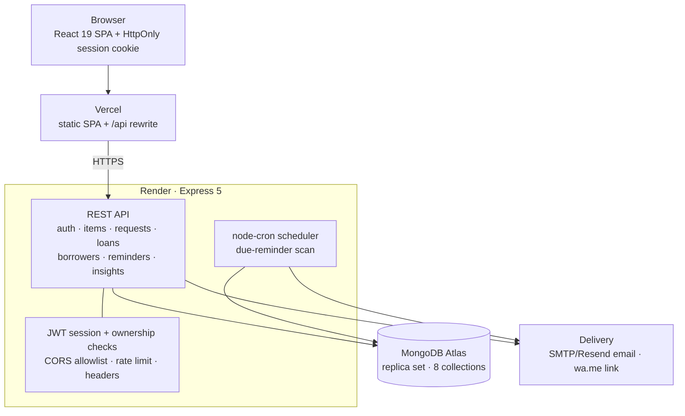
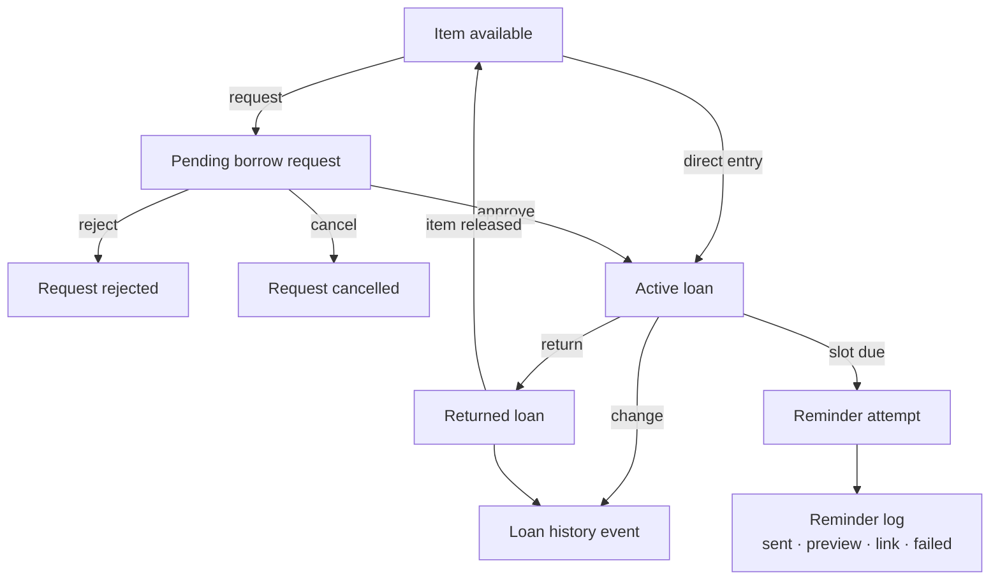
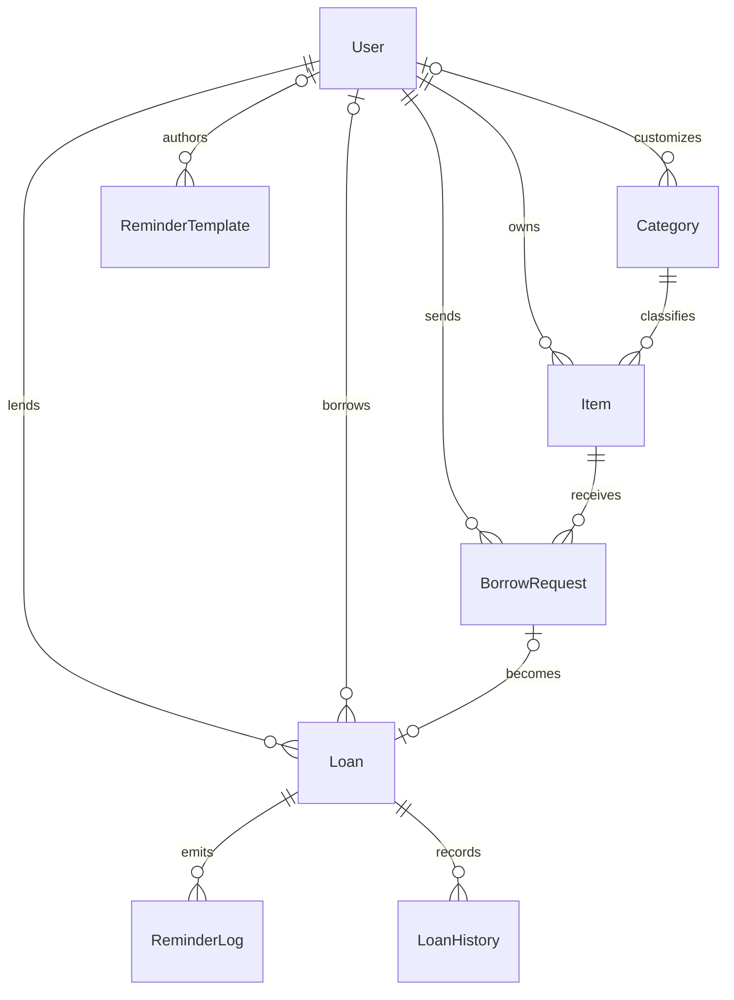

<p align="center">
  <picture>
    <source media="(prefers-color-scheme: dark)" srcset="docs/assets/brand/wordmark-on-dark.svg">
    
  </picture>
</p>

<p align="center">
  <strong>Borrow and lend, without the buy.</strong><br>
  A full-stack lending library for households, student clubs, labs and small teams —
  inventory, borrow requests, loan deadlines, consent-aware reminders and privacy-first insights.
</p>

<p align="center">
  <a href="https://lend-loop-phi.vercel.app"><strong>Live app</strong></a> ·
  <a href="https://lendloop-gx0y.onrender.com/api/health">API health</a> ·
  <a href="https://github.com/Keninjavelas/LendLoop">Repository</a>
</p>

<p align="center">
  
  
  
  
  
</p>

<p align="center">
  <a href="#overview">Overview</a> ·
  <a href="#features">Features</a> ·
  <a href="#screenshots">Screenshots</a> ·
  <a href="#architecture">Architecture</a> ·
  <a href="#api-reference">API</a> ·
  <a href="#security-and-privacy">Security</a> ·
  <a href="#getting-started">Getting started</a> ·
  <a href="#roadmap">Roadmap</a>
</p>

---

## Overview

LendLoop is a peer-to-peer lending manager. It replaces the spreadsheet-and-memory approach with a shared record of what you own, who has it, when it is due back, and what happened last time.

It supports two ways of lending:

- **Listed inventory** — add an item to your shelf, let a borrower request it, then approve or reject the request. Approval creates the loan and marks the item as borrowed in one transaction.
- **Direct ledger entries** — record something you lent outside the platform. You can attach an existing listing or keep the entry unlisted, which makes LendLoop useful as a complete lending history rather than only a catalogue.

Both directions are tracked. A loan can be something you lent to someone else or something you borrowed from another account. The dashboard, loans view, reminders and insights all respect that distinction.

The project is a production-deployed MERN application: a React SPA on Vercel, an Express API on Render, and MongoDB Atlas for persistence. Authentication uses a first-party, `HttpOnly` cookie; the deployed SPA reaches the API through a Vercel rewrite so the cookie stays on the Vercel origin.

| | |
| :--- | :--- |
| **Product type** | Full-stack lending library and loan ledger |
| **Primary users** | Households, clubs, labs, classrooms and small teams |
| **Core loop** | List or record → request or agree → lend → remind → return → learn |
| **Frontend** | React 19, Vite 8, Tailwind CSS 4, React Router 7 |
| **Backend** | Node.js 22, Express 5, Mongoose 9 |
| **Database** | MongoDB with a replica set for multi-document transactions |
| **Deployment** | Vercel (SPA + `/api` proxy) · Render (API + scheduler) · Atlas M0 |

---

## Features

### Lending operations

| Surface | Capabilities |
| :--- | :--- |
| **Dashboard** | Directional totals for lent and borrowed items, overdue queues in both directions, requests waiting on you, upcoming deadlines, scheduled reminder slots, recently returned loans, a snapshot of your shelf and reminder health. Every summary links to the filtered view it describes. |
| **Inventory** | Add, edit, archive and restore items with a title, description, category, condition and optional image URL. Search, filter and sort the catalogue. Items are `available`, `borrowed` or `archived`; deleting an item that has loan history archives it instead of destroying the record. |
| **Explore** | A public catalogue of available items. Signed-in visitors can open an item and send a borrow request with a requested return date and an optional message. |
| **Borrowers** | A directory built from your lending history. Account-linked borrowers and manually recorded borrower snapshots are kept deliberately separate rather than merged into a guessed identity. Each entry shows prior loans, active loans, overdue loans, last lending date and current loans. Access is limited to lenders with an existing relationship. |
| **Requests** | Incoming and outgoing request lists with approve, reject and cancel actions. Borrowers cannot request their own items, unavailable items, or create a second pending request for the same item. Approval is transactional: it creates the loan and flips the item to `borrowed`. |
| **Loans** | Manual lending entries and request-origin loans in one list. Change deadlines, priority and categories with a recorded history event, filter by direction/status/priority/overdue, open a loan's full history, send a reminder by hand and record a return. Overdue is derived from the due date rather than stored as a separate state. |
| **Loan detail** | Item and borrower context, reminder readiness, next scheduled attempt, deadline and priority controls, a return dialog with an optional note and borrower-confirmation flag, and a chronological history of created, deadline, priority, category, reminder and return events. |

### Automation, analytics and account surfaces

| Surface | Capabilities |
| :--- | :--- |
| **Reminders** | Priority-based schedules, per-loan channel selection, consent and contact readiness, manual sends, previews, scheduled attempts, delivery-status history, retries and scheduler health. Email and WhatsApp are modelled as separate channels with honest status semantics. |
| **Templates & categories** | Six shared categories and six shared reminder templates are seeded on first run. Lenders can add their own categories and templates, and choose general, priority, category or custom reminder content. Template placeholders are validated and rendered per loan. |
| **Insights** | A selectable date range with a live snapshot, range totals, return-timing metrics, monthly lending volume, category distribution and reminder activity by channel and status. A loan-level CSV export is privacy-minimised and neutralises spreadsheet formulas. |
| **Accounts & privacy** | Register, log in and log out with an `HttpOnly` cookie session. Update profile details, change the password and delete the account. Password changes and deletion rotate the session version so previously issued tokens stop working. Deletion anonymises retained lending records instead of leaving personal data behind. |
| **Responsive UI** | A desktop sidebar and mobile bottom navigation, a charcoal/electric-green design system, focus-visible outlines, labelled forms and focus-managed dialogs. The layout adapts from a 1440 px dashboard to a 390 px phone without dropping the core actions. |

### How reminders behave

| Priority | Default pre-due slots | Default channels |
| :--- | :--- | :--- |
| **Low** | 1 day before the deadline | Email |
| **Medium** | 2 days before and on the deadline | Email |
| **High** | 3 days before, 1 day before and on the deadline | Email, WhatsApp |

After the deadline, reminders repeat at the loan's overdue interval (48 hours by default) up to a configurable cap (5 by default). A lender can override channels, switch to a manual or custom schedule and supply a custom message.

Priority never overrides consent. A channel is usable only when the lender selected it, the borrower consented to it and a valid contact detail exists. Loans with no usable channel show as **blocked** and nothing is sent.

| Log status | What it means |
| :--- | :--- |
| `sent` | The email provider accepted the message. Delivery to the recipient's inbox is **not** tracked. |
| `preview` | The message was rendered and recorded without contacting a provider. This is the production demo's current mail mode. |
| `link` | A prefilled `wa.me` link was generated for WhatsApp. It is not a WhatsApp API delivery. |
| `failed` | The provider rejected the attempt or a required contact detail was missing; the error is recorded. |

Scheduled reminders are deduplicated per loan, reminder slot and channel, and the scheduler ignores slots older than a 24-hour catch-up window. An offline or sleeping API therefore cannot dump a backlog of stale messages on a borrower when it wakes.

---

## Screenshots

All screenshots are real captures of this application, taken on 2026-10-18 at a 1440 × 900 desktop viewport (and 390 × 844 for the mobile view), running locally against a disposable demo database. Names, items and loan records shown are fixture data, not production user data.

| Dashboard | Inventory |
| :---: | :---: |
| [](docs/assets/screenshots/dashboard.png) | [](docs/assets/screenshots/inventory.png) |
| <sub>Operational overview with directional totals and queues.</sub> | <sub>Inventory management with categories, filters and item actions.</sub> |

| Loans | Reminders |
| :---: | :---: |
| [](docs/assets/screenshots/loans.png) | [](docs/assets/screenshots/reminders.png) |
| <sub>Loan lifecycle filters, reminders and return actions.</sub> | <sub>Reminder control centre with honest delivery states and blocked-entry warnings.</sub> |

| Insights | Mobile |
| :---: | :---: |
| [](docs/assets/screenshots/insights.png) | [](docs/assets/screenshots/dashboard-mobile.png) |
| <sub>Range-based lending metrics and reminder activity.</sub> | <sub>The same dashboard at a 390 px viewport.</sub> |

---

## Architecture



| Component | Responsibility |
| :--- | :--- |
| **React SPA** | Renders public and protected routes, keeps the session in context, and calls the API with axios and `withCredentials`. |
| **Vercel** | Serves the static build, falls back to `index.html` for deep links, and rewrites `/api/*` to the Render service. |
| **Express API** | Owns authentication, authorization, validation, loan invariants, reminder orchestration, insights and CSV export. |
| **Reminder scheduler** | Runs inside the API process on a cron expression (every minute by default), scans active loans and dispatches due slots. |
| **MongoDB Atlas** | Stores the eight collections and enforces unique/partial indexes. Replica-set transactions cover approvals, direct loan creation, returns and account deletion. |
| **Mail provider** | Selected with `MAIL_DRIVER`: `preview` renders and logs, `smtp` uses any SMTP server, `resend` uses Resend over SMTP. |
| **WhatsApp** | Deliberately link-only in this version: the service returns a prefilled `wa.me` URL rather than claiming a business-initiated send. |

### Why `/api` is proxied

The session cookie is `HttpOnly`, `Secure` in production, `SameSite=Lax` and host-only. Vercel and Render are different sites, so a browser would not send that cookie on a direct cross-origin request to Render. Routing `/api/*` through the Vercel origin keeps authentication first-party and avoids relaxing the cookie to `SameSite=None`, which would require a separate CSRF defence.

```json
{
  "rewrites": [
    {
      "source": "/api/:path*",
      "destination": "https://lendloop-gx0y.onrender.com/api/:path*"
    },
    {
      "source": "/(.*)",
      "destination": "/index.html"
    }
  ]
}
```

---

## Lending lifecycle



| Entity | States | Notes |
| :--- | :--- | :--- |
| **Item** | `available` · `borrowed` · `archived` | `borrowed` follows an active linked loan. Archive and restore are explicit owner actions; deletion with history archives instead of removing. |
| **Borrow request** | `pending` · `approved` · `rejected` · `cancelled` | At most one pending request per borrower and item. Approval produces at most one loan. |
| **Loan** | `active` · `returned` | Overdue is calculated from `dueDate`; it is never stored as a status. A returned loan keeps its reminder preferences for the record but is no longer armed. |
| **Reminder log** | `sent` · `preview` · `link` · `failed` | A log records an attempt and its provider outcome; it does not claim inbox delivery. |

A few behaviours are intentional:

- **Only the lender closes a loan.** Borrowers can view their active loans, but the return endpoint rejects them with `403`.
- **Returns are recorded, not assumed.** A lender supplies a return timestamp and optional note and can mark that the borrower confirmed the return; the item then becomes available again.
- **History is append-only.** Deadline, priority, category, reminder and status changes each create a history entry with actor and reason, so the loan's past stays inspectable.
- **A backdated entry starts overdue.** Recording a loan from last week is allowed; the reminder engine only schedules future-relevant slots instead of retroactively firing every missed one.

---

## Data model



The diagram shows the core relationships. Secondary references kept on documents — `request.ownerId`, `loan.categoryId`, `loan.itemId`, `reminderLog.lenderId` and `loanHistory.actorId` — are enforced by the schemas and covered by the invariants below.

<details>
<summary><strong>Collection reference</strong></summary>

| Collection | Purpose | Key fields |
| :--- | :--- | :--- |
| `users` | Account identity and session version | `name`, `email` (unique, lowercase), `passwordHash`, `profile`, `preferences`, `authVersion`, `deletedAt` |
| `items` | Shelf inventory | `ownerId`, `title`, `description`, `categoryId`, `condition`, `imageUrl`, `status` |
| `borrow_requests` | Incoming and outgoing requests | `itemId`, `borrowerId`, `ownerId`, `message`, `requestedReturnDate`, `status` |
| `loans` | Lending ledger, both directions | `origin`, `requestId`, `itemId`, `itemName`, `categoryId`, `lenderId`, `borrowerId`, borrower snapshot and consent, `lentAt`, `dueDate`, `returnedAt`, `status`, `priority`, `notes`, `reminders` |
| `categories` | Shared and custom taxonomy | `ownerId`, `name`, `defaultPriority`, `isSystem` |
| `reminder_templates` | Message content by scope | `ownerId`, `name`, `scope`, `priority`, `categoryId`, `subject`, `body` |
| `reminder_logs` | Every delivery attempt and outcome | `loanId`, `lenderId`, `channel`, `mode`, `dedupeKey`, `status`, `provider`, `link`, `error`, `sentAt` |
| `loan_history` | Append-only audit trail | `loanId`, `actorId`, `kind`, `reason`, timestamps |

</details>

### Invariants and indexes

| Invariant | Enforcement |
| :--- | :--- |
| One active loan per item | Partial unique index on `loans { itemId: 1 }` where `status = active` and `itemId` is an ObjectId. Unlisted manual entries (`itemId: null`) are excluded by a `$type` guard. |
| One loan per approved request | Partial unique index on `loans { requestId: 1 }` for ObjectId request ids. Manual entries have no request id. |
| One pending request per borrower and item | Partial unique index on `borrow_requests { itemId: 1, borrowerId: 1 }` where `status = pending`. |
| One reminder per slot and channel | Partial unique index on `reminder_logs { loanId: 1, dedupeKey: 1 }` for string keys. Concurrent or overlapping scheduler runs cannot double-send. |
| Ownership is checked on every private route | Controllers scope queries by the authenticated user; item, loan, request, category and template mutations verify the caller's role. |
| A linked borrower is a real prior relationship | A loan can reference an account as borrower only when this lender has lent to that account before. |
| Account deletion is consistent | Items are archived, pending requests cancelled, messages cleared, retained snapshots and history anonymised, triggered reminder logs removed and the user row replaced with a tombstone — inside a transaction. |

### Why borrower data is duplicated on a loan

A `Loan` stores a borrower snapshot (name, email, phone and consent) alongside an optional `borrowerId`. The snapshot is what the loan record showed at the time it was created, so deleting an account does not erase the lending history of the other party. The borrower directory treats linked accounts and manual snapshots as separate rows rather than guessing that two people with the same name are the same person.

---

## Technology stack

| Layer | Technology | Why it is used |
| :--- | :--- | :--- |
| **UI runtime** | React 19 | Component model and hooks for a stateful dashboard, forms, dialogs and protected routes. |
| **Build tool** | Vite 8 | Fast local development, a dev proxy for `/api`, and a static production build for Vercel. |
| **Styling** | Tailwind CSS 4 + custom CSS theme tokens | A compact utility workflow with a deliberate charcoal, electric-green design system rather than ad-hoc colours. |
| **Routing** | React Router 7 | Public routes, protected routes and deep-linkable detail pages. |
| **HTTP client** | Axios | A single configured client for JSON requests and cookie credentials. |
| **Notifications** | Sonner | Accessible toast feedback for actions and errors. |
| **Icons** | lucide-react | A consistent, tree-shakable icon set. |
| **API runtime** | Node.js 22 + Express 5 | A small, explicit REST service with async route handling and a familiar middleware model. |
| **ODM** | Mongoose 9 | Schemas, enums, validation, indexes, population and transactions. |
| **Auth** | bcryptjs + jsonwebtoken | Password hashing at cost factor 12 and signed, cookie-based sessions. |
| **Scheduling** | node-cron | An in-process reminder scheduler with an overlap guard and a configurable cron expression. |
| **Email** | Nodemailer | One interface for preview, SMTP and Resend over SMTP, selected by `MAIL_DRIVER`. |
| **Database** | MongoDB Atlas | Document modelling for snapshots and history, plus a replica set for transactions. |
| **Tests** | Node.js built-in test runner | No extra test framework; backend integration tests and client logic tests run with `node --test`. |
| **Deployment** | Vercel + Render | Static SPA hosting and a separately deployable API, with `/api` proxying to keep cookies first-party. |
| **Local tooling** | concurrently, nodemon | One command starts both apps; the API restarts on source changes. |

---

## Project structure

```text
LendLoop/
├── client/
│   ├── src/
│   │   ├── assets/                 # Static client assets
│   │   ├── components/
│   │   │   ├── common/             # Buttons, fields, badges, modals, empty states
│   │   │   ├── items/              # Item cards, filters and forms
│   │   │   ├── layout/             # App shell, sidebar, mobile nav, protected route
│   │   │   ├── loans/              # Loan cards, lending wizard, return and reminder dialogs
│   │   │   ├── requests/           # Request cards and actions
│   │   │   └── templates/          # Reminder template forms
│   │   ├── context/                # Authentication and app state
│   │   ├── hooks/                  # Shared client hooks
│   │   ├── pages/                  # 19 route-level page components
│   │   ├── services/               # API client and feature services
│   │   ├── utils/                  # Formatting and client helpers
│   │   ├── App.jsx                 # Route map
│   │   ├── index.css               # Tailwind theme tokens and base styles
│   │   └── main.jsx
│   ├── test/                       # Client logic tests
│   ├── vite.config.js              # Dev server and /api proxy
│   └── vercel.json                 # Production rewrites
├── server/
│   ├── src/
│   │   ├── config/                 # Environment validation, database, default seeds
│   │   ├── controllers/            # Auth, user, item, request, loan, reminder, insight logic
│   │   ├── jobs/                   # Reminder scheduler
│   │   ├── middleware/             # Auth, rate limiting, validation, errors
│   │   ├── models/                 # Eight Mongoose schemas and indexes
│   │   ├── routes/                 # Express routers
│   │   ├── services/               # Reminder, deadline, email and WhatsApp services
│   │   ├── utils/                  # Constants, tokens, template rendering
│   │   ├── app.js                  # Express app, security middleware and route mounts
│   │   └── server.js               # Startup, shutdown and scheduler lifecycle
│   ├── scripts/                    # seed.js and migrate.js
│   ├── test/                       # Six integration test files and helpers
│   ├── .env.example
│   └── package.json
├── docs/assets/                    # README screenshots and brand assets
├── package.json                    # Root scripts and concurrently
└── README.md
```

---

## Getting started

### Prerequisites

- **Node.js 22** (verified on 22.20.0) and npm.
- **MongoDB** with a replica set enabled. Transactions are required for request approval, direct loan creation, returns and account deletion. Atlas replica sets work by default; a local single-node set must be initiated as replica set `rs0`.
- Git.

### Install

```bash
git clone https://github.com/Keninjavelas/LendLoop.git
cd LendLoop
npm run install:all
```

### Configure the server

Copy the example environment files:

```bash
cp server/.env.example server/.env
cp client/.env.example client/.env
```

Set at least these values in `server/.env`:

```dotenv
NODE_ENV=development
PORT=5000

MONGODB_URI=mongodb://localhost:27017/lendloop?replicaSet=rs0
MONGODB_URI_TEST=mongodb://localhost:27017/lendloop_test?replicaSet=rs0

JWT_SECRET=<at-least-32-random-characters>
CLIENT_URL=http://localhost:5173

SERVE_CLIENT=false
MAIL_DRIVER=preview
```

Generate a suitable secret locally:

```bash
node -e "console.log(require('crypto').randomBytes(48).toString('base64url'))"
```

Keep `client/.env` at the first-party path:

```dotenv
VITE_API_URL=/api
```

Vite proxies `/api` to `http://localhost:5000` in development; the Vercel rewrite provides the same path in production.

### Seed shared defaults

```bash
npm --prefix server run seed
```

This adds the six shared categories and six shared reminder templates, leaves existing rows untouched, and creates **no user accounts or sample loans**. The app is idempotent across reseeds.

### Run both apps

```bash
npm run dev
```

- Client: `http://localhost:5173`
- API: `http://localhost:5000`
- Health: `http://localhost:5000/api/health`

Open the client, choose **Create one**, and register your own account. There are no demo credentials in this repository.

### Useful commands

| Command | Purpose |
| :--- | :--- |
| `npm run dev` | Start the API and Vite together with `concurrently`. |
| `npm run dev:server` | Start only the API with nodemon. |
| `npm run dev:client` | Start only the Vite client. |
| `npm run build` | Build the client for production. |
| `npm start` | Start the API in production mode. |
| `npm --prefix server run seed` | Seed shared categories and templates. |
| `npm --prefix server run migrate` | Run the migration script for legacy records. |
| `npm --prefix server test` | Run the backend test suite. |
| `npm --prefix client test` | Run the client logic tests. |

### Run the tests

```bash
# Backend: requires MONGODB_URI_TEST from server/.env
npm --prefix server test

# Client logic tests
npm --prefix client test

# Production build
npm run build
```

The backend test helper refuses to run if `MONGODB_URI_TEST` is missing, if its database name does not end in `_test`, or if it points at the same database as `MONGODB_URI`. The suite drops that test database before and after the run. Use a dedicated database, never your development data.

On PowerShell, override the test URI for one session with:

```powershell
$env:MONGODB_URI_TEST = "mongodb://localhost:27017/lendloop_test?replicaSet=rs0"
npm --prefix server test
```

---

## API reference

Base path: `http://localhost:5000/api` in development, or `/api` through the Vercel origin in production. Requests and responses are JSON. Authentication is the `lendloop_token` cookie, set by `/auth/register` and `/auth/login`; send it with `credentials: 'include'` (axios) or a curl cookie jar.

| Area | Endpoints | Access |
| :--- | :--- | :--- |
| **Health** | `GET /health` | Public. Returns `200` with the database state, or `503` when disconnected. |
| **Auth** | `POST /auth/register` · `POST /auth/login` · `POST /auth/logout` · `GET /auth/me` | Public for register/login; session for logout and me. |
| **Account** | `GET /users/me` · `PATCH /users/me` · `PATCH /users/me/password` · `DELETE /users/me` | Session. Deletion requires the current password and a typed confirmation; it is blocked while active loans exist. |
| **Items** | `GET /items` · `GET /items/:id` · `POST /items` · `GET /items/mine` · `PATCH /items/:id` · `DELETE /items/:id` · `PATCH /items/:id/archive` · `PATCH /items/:id/restore` | Catalogue and item detail are public/optional-auth; mutations require the owner. |
| **Categories** | `GET /categories` · `POST /categories` · `PATCH /categories/:id` · `DELETE /categories/:id` | Session. Shared categories are read-only defaults; custom categories belong to the creator. |
| **Requests** | `POST /requests` · `GET /requests/incoming` · `GET /requests/outgoing` · `PATCH /requests/:id/approve` · `PATCH /requests/:id/reject` · `PATCH /requests/:id/cancel` | Session. The borrower creates/cancels; the item owner approves/rejects. |
| **Loans** | `GET /loans` · `POST /loans` · `GET /loans/:id` · `PATCH /loans/:id` · `PATCH /loans/:id/deadline` · `PATCH /loans/:id/priority` · `PATCH /loans/:id/category` · `PATCH /loans/:id/return` · `GET /loans/:id/history` · `GET /loans/:id/reminders` · `POST /loans/:id/reminders` · `GET /loans/:id/reminders/preview` · `GET /loans/:id/reminders/schedule` | Session; scoped to the lender or borrower on the loan, with lender-only mutations. |
| **Borrowers** | `GET /borrowers` · `GET /borrowers/:id` | Session. Only identities with a lending relationship to the caller are visible. |
| **Reminders** | `GET /reminders` · `GET /reminders/overview` · `POST /reminders/:id/retry` · `POST /reminders/run` | Session; lender-scoped logs and actions. `/run` is an operational trigger for due scans. |
| **Templates** | `GET /templates` · `POST /templates` · `PATCH /templates/:id` · `DELETE /templates/:id` | Session; shared templates plus the caller's own templates. |
| **Insights** | `GET /insights` · `GET /insights/export` | Session. Both accept `from` and `to` query parameters (default: the last 90 days; maximum span: three years). |

Errors use an HTTP status plus a JSON message, for example `{ "message": "You already have a pending request for this item" }`. Validation failures are `400`, unauthenticated requests `401`, authorization failures `403`, missing records `404`, and conflicts such as a duplicate pending request `409`.

### Example: register, create an item and request it

```bash
# 1. Register a lender. -c stores the HttpOnly session cookie.
curl -s -c lender.txt -X POST http://localhost:5000/api/auth/register \
  -H 'Content-Type: application/json' \
  -d '{"name":"Avery Chen","email":"avery@example.test","password":"<your-password>"}'

# 2. Read the shared categories and take an _id from the response.
curl -s -b lender.txt http://localhost:5000/api/categories

# 3. Create a listing.
curl -s -b lender.txt -X POST http://localhost:5000/api/items \
  -H 'Content-Type: application/json' \
  -d '{
    "title": "Cordless drill",
    "description": "Cordless drill with two batteries and a charger",
    "categoryId": "<category-id>",
    "condition": "Good"
  }'

# 4. As a borrower, request the item.
curl -s -c borrower.txt -X POST http://localhost:5000/api/auth/register \
  -H 'Content-Type: application/json' \
  -d '{"name":"Jordan Lee","email":"jordan@example.test","password":"<borrower-password>"}'

curl -s -b borrower.txt -X POST http://localhost:5000/api/requests \
  -H 'Content-Type: application/json' \
  -d '{
    "itemId": "<item-id>",
    "requestedReturnDate": "2026-12-01T00:00:00.000Z",
    "message": "Could I borrow this for a weekend project?"
  }'

# 5. As the owner, approve it. The loan is created and the item becomes borrowed
#    in a single transaction.
curl -s -b lender.txt -X PATCH \
  http://localhost:5000/api/requests/<request-id>/approve
```

### Example: preview and schedule a reminder

```bash
# Render the message without sending anything.
curl -s -b lender.txt \
  "http://localhost:5000/api/loans/<loan-id>/reminders/preview?mode=priority"

# Inspect the computed slots, sent state, usable channels and next due time.
curl -s -b lender.txt \
  http://localhost:5000/api/loans/<loan-id>/reminders/schedule

# Send a manual reminder on the selected channels.
curl -s -b lender.txt -X POST \
  http://localhost:5000/api/loans/<loan-id>/reminders \
  -H 'Content-Type: application/json' \
  -d '{"channels":["email"],"templateMode":"priority"}'
```

A preview returns the rendered subject and body, the loan's usable channels, readiness and prefilled links. It does not create a delivery claim.

---

## Security and privacy

### Implemented controls

| Control | Implementation |
| :--- | :--- |
| **Password storage** | bcrypt hashing at cost factor 12. Passwords are never returned by the API; `passwordHash` is `select: false`. |
| **Session transport** | Signed JWT in the `lendloop_token` cookie: `HttpOnly`, `Secure` in production, `SameSite=Lax`, `Path=/`, 7-day expiry. The production proxy keeps it first-party. |
| **Session revocation** | Tokens carry an `authVersion` claim. Password changes and account deletion increment the user's version, invalidating previously issued tokens. |
| **Route protection** | `protect` requires a valid session; `optionalProtect` exposes only public data to anonymous visitors. Every private controller scopes by ownership or relationship. |
| **Credential rate limiting** | A per-IP fixed-window limiter on login and registration (default 20 attempts per 15 minutes) with `RateLimit` headers and `Retry-After` on `429`. |
| **CORS** | Credentialed requests are allowed only from origins parsed from the comma-separated `CLIENT_URL` allowlist. |
| **Security headers** | `nosniff`, `X-Frame-Options: DENY`, `no-referrer`, a restrictive `Permissions-Policy`, `Cross-Origin-Opener-Policy: same-origin`, and HSTS in production. |
| **Input boundaries** | Mongoose schemas, enum checks and explicit controller validation; JSON bodies are limited to 100 kB. |
| **Data invariants** | Partial unique indexes for pending requests, active loans, request-to-loan conversion and reminder deduplication, backed by transactions for multi-collection operations. |
| **Account deletion** | Password-confirmed deletion that anonymises retained records rather than orphaning personal data. It refuses to proceed while active loans exist. |
| **Export safety** | CSV export contains loan facts and borrower names but no email addresses or phone numbers; cells beginning with `=`, `+`, `-` or `@` are neutralised against spreadsheet formula injection. |
| **Secret handling** | Environment files are ignored, `server/.env.example` contains placeholders only, and startup rejects missing, short or placeholder `JWT_SECRET` values. |

<details>
<summary><strong>What account deletion removes and retains</strong></summary>

Deletion runs inside a transaction and requires the current password plus a typed confirmation. It:

- archives the user's items;
- cancels their pending borrow requests and clears message text addressed to them;
- anonymises borrower snapshots and retained history so the other party's lending record remains meaningful;
- removes reminder logs the user triggered;
- replaces the account with a non-routable tombstone (`Deleted account` and a `deleted-*.deleted.lendloop.invalid` address), rotates the password hash and increments the session version;
- clears the auth cookie.

Retained loans and history are intentionally preserved for the counterparty's record, but they no longer identify the deleted person by their original name or email in the deleted account's own profile. This is documented product behaviour, not a claim that every byte is physically erased.

</details>

### Recommended before a public launch

These are **not currently implemented** and should not be inferred from the feature list:

- Email verification, password reset and optional MFA.
- A real transactional email provider with bounce/complaint webhooks and delivery tracking. The live deployment currently uses `MAIL_DRIVER=preview`, so scheduled emails are recorded but not delivered.
- WhatsApp Business API delivery through approved templates, rather than prefilled links.
- Distributed rate limiting and account lockout if the API runs more than one instance.
- Object storage and virus scanning for uploaded item images; the current field accepts a URL only.
- Centralised logs, alerting, automated backups and an incident runbook.
- Automated browser end-to-end tests and a formal accessibility audit.
- A CSRF token if the deployment ever moves to `SameSite=None` or direct cross-origin cookie auth.

---

## Testing and quality

The project uses Node's built-in test runner for both applications. No test-count badge is published because the numbers below are a dated snapshot, not a continuously verified status.

| Gate | Command | Last verified | Result |
| :--- | :--- | :--- | :--- |
| **Backend API tests** | `npm --prefix server test` (with `MONGODB_URI_TEST` set) | 2026-10-18 | **43 passed**, 0 failed, across 6 files; 44.76 s |
| **Client logic tests** | `npm --prefix client test` | 2026-10-18 | **14 passed**, 0 failed, across 2 files; 236.7 ms |
| **Production build** | `npm run build` | 2026-10-18 | Exit 0; Vite 8.3.4 built 2,050 modules in 1.02 s (this machine) |
| **Live health check** | `GET https://lendloop-gx0y.onrender.com/api/health` | 2026-10-18 | `200 {"status":"ok","database":"up"}` |

The client build produced `681.53 kB` of JavaScript (`189.15 kB` gzip) and `43.38 kB` of CSS (`8.07 kB` gzip), with Vite's standard warning that the main chunk exceeds 500 kB. That warning is expected at this size and has not been suppressed.

Backend coverage includes environment validation, the credential limiter, registration/login/logout, password change and account deletion, cross-account isolation, request approval and duplicate guards, one-active-loan-per-item enforcement, the return lifecycle, borrower visibility, reminder scheduling/dedupe/consent and insights/CSV behaviour. Client tests cover the lending-entry payload builder and date formatting.

### Known testing limits

- There is **no automated browser E2E suite**. The production auth flow, lending workflow and responsive pages were verified manually through the live deployment and local browser sessions.
- Tests require a MongoDB replica set. They are integration tests against a real database, not mocked repositories.
- No coverage percentage is reported; the repository does not configure a coverage provider.
- The in-memory rate limiter is unit-tested for windowing and IP fallback, not load-tested across instances.

### Test database safety

`server/test/helpers.js` enforces three conditions before connecting:

1. `MONGODB_URI_TEST` exists.
2. The database name ends in `_test`.
3. It is not the same database as `MONGODB_URI`.

It then drops the test database before and after the suite. This makes it difficult to accidentally wipe development or production data when running tests.

---

## Insights and reporting

Insights is a read-only analytical layer over the caller's loans and reminder logs. It accepts `from` and `to` query parameters in `YYYY-MM-DD` form. Date-only ranges are inclusive at both ends and interpreted as UTC calendar days; the default window is 90 days and the maximum span is three years.

| Metric group | What is measured |
| :--- | :--- |
| **Live snapshot** | Active lent, active borrowed, overdue lent and overdue borrowed — current state, not limited to the selected range. |
| **Range totals** | Loans started, still active, returned and overdue now for loans whose `lentAt` falls in the range. |
| **Return timing** | Completed returns in the range, on-time vs late, average completed duration, and an on-time rate. The rate is withheld until there are at least 5 completed returns with timestamps, so a tiny sample is not presented as a reliability score. |
| **Volume** | Monthly loan counts over the selected range, keyed in UTC. |
| **Category mix** | The top eight categories by loan count in the range. |
| **Reminder activity** | Log counts by channel and status. `sent` means a provider accepted the email; delivery is not tracked, and WhatsApp link generation is shown separately. |

The CSV export is loan-level and intentionally omits borrower contact details. It includes item, borrower name, linked-account flag, category, priority, lending/due/return timestamps, status, overdue and late flags, and the return note. A UTF-8 BOM keeps Excel from mangling non-ASCII names, and formula-leading cells are prefixed so a malicious value cannot execute as a spreadsheet formula.

No usage statistics are claimed in this README. The numbers visible in the Insights screenshot come from the disposable demo dataset used for the capture.

---

## Deployment

The production topology is intentionally split:

| Platform | Role | Configuration |
| :--- | :--- | :--- |
| **Vercel** | Static SPA, `/api/*` rewrite and SPA fallback | Root build output from `client/`; `client/vercel.json` owns rewrites. |
| **Render** | Express API and reminder scheduler | Root `server/`; build `npm ci`; start `npm start`; health check `/api/health`; Free instance in Oregon. |
| **MongoDB Atlas** | Persistence and transactions | M0 replica set, database `lendloop`, least-privilege application user with `readWrite` on that database. |

The live app is at **https://lend-loop-phi.vercel.app** and the API health endpoint is **https://lendloop-gx0y.onrender.com/api/health**.

### Production environment shape

These are the meaningful server variables; secrets stay in the Render dashboard and are never committed.

| Variable | Purpose / production note |
| :--- | :--- |
| `NODE_ENV` | `production`. Enables secure cookies and HSTS. |
| `PORT` | Provided by Render; no manual value is required. |
| `MONGODB_URI` | Atlas connection string. Secret. |
| `JWT_SECRET` | At least 32 random characters. Secret; startup rejects placeholders. |
| `CLIENT_URL` | `https://lend-loop-phi.vercel.app` — the CORS allowlist and the origin used in links. |
| `SERVE_CLIENT` | `false`; Vercel serves the SPA and Express stays API-only. |
| `TRUST_PROXY` | `1` behind Render's single proxy so client IPs and rate limiting behave correctly. |
| `NODE_VERSION` | `22.20.0`, matching the verified runtime. |
| `NODE_OPTIONS` | `--use-system-ca` in this deployment so Node trusts Atlas' certificate chain while verification remains enabled. |
| `REMINDER_SCHEDULER_ENABLED` | `true` on Render. Set `false` to run the API without the cron scan. |
| `MAIL_DRIVER` | `preview` in the live demo. Set `smtp` or `resend` plus provider credentials for real email. |

### Free-tier and operational limits

- **Render Free sleeps after 15 minutes of inactivity.** Cold starts add latency to the first request. The in-process scheduler only runs while the service is awake, so reminders are best-effort; the 24-hour catch-up window prevents a stale backlog from being flushed all at once.
- **The scheduler is not a separate worker.** Running multiple API instances would duplicate scans; unique reminder logs prevent duplicate sends, but a dedicated worker or a distributed lock is the correct next step for scale.
- **Rate limiting is in memory.** Limits reset on restart and are not shared across processes.
- **Atlas M0 is a shared free tier.** It is appropriate for a demo and small groups, not a guarantee of production availability or dedicated backup SLAs.
- **The live demo does not send email.** `MAIL_DRIVER=preview` renders and records messages; WhatsApp produces links. Do not treat the production demo as a delivery system.
- **Atlas network access currently permits Render's dynamic egress.** Narrow it if stable egress addresses become available.
- **Images are URLs, not uploads.** There is no object-storage service or malware scanning in this version.

---

## Roadmap

### Shipped

- [x] Account registration, login, logout and session restoration with an HttpOnly cookie
- [x] Profile editing, password change and version-based session revocation
- [x] Password-confirmed account deletion with anonymised retention
- [x] Public catalogue, owner inventory, categories and archive/restore
- [x] Borrow requests with duplicate guards and transactional approval
- [x] Manual lending entries and request-origin loans
- [x] Deadline, priority and category changes with append-only history
- [x] Return lifecycle with notes, borrower confirmation and item availability
- [x] Borrower directory with relationship-scoped visibility
- [x] Consent-aware email/WhatsApp reminders, templates, previews, retries and scheduler dedupe
- [x] Dashboard, reminder control centre, insights and CSV export
- [x] Responsive dark UI with desktop and mobile navigation
- [x] Backend integration tests, client logic tests and a production build gate
- [x] Live deployment on Vercel, Render and Atlas

### Next

- [ ] Activate a real transactional email provider in production and track delivery/bounce events
- [ ] Add automated browser E2E coverage for auth, requests, returns and reminder controls
- [ ] Replace item image URLs with uploads to object storage
- [ ] Add email verification, password reset and optional MFA
- [ ] Move rate limiting to a shared store for multi-instance deployments
- [ ] Add a delivery webhook/worker path for WhatsApp Business API templates

### Exploring

- [ ] Progressive web app and offline viewing of cached loans
- [ ] Calendar export or sync for due dates
- [ ] OAuth sign-in for organizations that already manage identity elsewhere
- [ ] Native mobile shell for clubs and labs

The roadmap separates what is deployed today from directional work. Items under **Next** and **Exploring** are not implemented and have no committed delivery dates.

---

## Contributing

Issues and focused pull requests are welcome. Before opening a larger PR, describe the problem and the proposed boundary so the change stays reviewable.

1. Fork the repository and create a branch from `main`.
2. Follow the existing structure and naming; keep unrelated refactors out of feature PRs.
3. Copy the environment examples and use a dedicated `_test` database.
4. Run the relevant checks before opening the PR:

   ```bash
   npm --prefix server test
   npm --prefix client test
   npm run build
   ```

5. Do not commit `.env` files, credentials, tokens, generated build output, logs or screenshot fixtures containing personal data.
6. Include a test for behavioural changes, especially anything touching authorization, loan invariants or reminder scheduling.

Be constructive and specific in reviews. There is no formal code of conduct file in this repository yet; the baseline expectation is respectful, good-faith collaboration.

---

## License

No license file is present in this repository. The source is publicly viewable, but no permission to reuse, redistribute or deploy it is granted by its presence here. If you want to use LendLoop beyond viewing and evaluating it, contact the repository owner and add an explicit license before doing so.

---

<p align="center">
  <sub>Built as a complete MERN lending workflow — inventory, requests, loans, reminders and insights.</sub>
</p>
